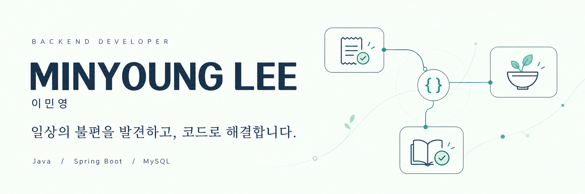

 

### 작은 불편에서 시작해, 실제로 쓰이는 서비스로 🌱

실생활에서 발견한 문제를 서비스로 만드는 **백엔드 개발자 이민영**입니다.  
반복되는 작업은 줄이고, 중요한 기록은 놓치지 않는 서비스를 만듭니다.

 

 

 

## 🧩 발견한 문제들

> “이 일을 조금 더 편하고 정확하게 할 수 없을까?”
>
> 제 프로젝트는 일상에서 마주한 이 질문에서 시작합니다.

 

### 🧾 쏙장부 · 영수증에서 장부까지 

수련회 정산 과정에서 영수증을 잘못 읽어 발생한  
**약 60만 원의 예산 오차**를 계기로 시작한 프로젝트입니다.

영수증 AI 인식과 장부 자동 정리를 통해  
반복적인 입력과 사람이 놓칠 수 있는 실수를 줄이고자 합니다.

`Spring Boot` `JPA` `MySQL` `Spring AI` `Gemini API` `React Native`

[쏙장부 바로가기 ↗](https://ssokledger.duckdns.org/)

> 출시 및 운영 중인 서비스로 소스 코드는 비공개입니다.

> 기획부터 프론트엔드·백엔드 개발, 배포까지 직접 진행했습니다.

 

### 🥗 오늘 뭐 먹지? · 냉장고 속 재료의 다음 이야기 

1~2인 가구를 위한 **냉장고 관리와 보유 재료 기반 레시피 추천 서비스**입니다.

자취할 시절 무엇을 먹을지 고민하는 것에서부터 시작되었습니다.
재료 관리부터 유통기한 확인, 레시피 탐색과 공유까지  
매일의 식사 고민을 하나의 흐름으로 연결합니다.

`Spring Boot` `JPA` `Spring Security` `JWT` `MySQL` `React`

[코드 보기 ↗](https://github.com/mins13/TodayWhatEat)

 

### 📖 리딩지저스 체크 · 꾸준함을 기록으로 

성경 읽기 완료 여부를 기록하고 확인하는 서비스입니다.

매일매일 여러명의 읽음 체크를 어떻게 해야하나에서부터 시작되었습니다.
매일의 체크와 기록 조회, 내보내기 기능으로  
함께 읽는 사람들의 진행 상황을 관리할 수 있도록 만들었습니다.

`Spring Boot` `JPA` `MySQL` `React`

[프론트 코드 보기 ↗](https://github.com/mins13/reading-jesus-front)

[백엔드 코드 보기 ↗](https://github.com/mins13/reading-jesus-check)

 

## 🌿 개발할 때 중요하게 생각하는 것

- **문제의 출발점** — 기능을 만들기 전에, 어떤 불편을 해결할지 생각합니다.
- **기록의 정확성** — 금액과 날짜처럼 작은 오류가 큰 차이를 만드는 데이터를 신중하게 다룹니다.
- **사용의 흐름** — 입력부터 결과 확인까지 사용자의 동선을 생각합니다.
- **끝까지 이어가기** — 구현한 기능이 실제 사용으로 이어지도록 완성해 나갑니다.

 

---

일상의 작은 불편을, 다음 프로젝트의 시작점으로.

